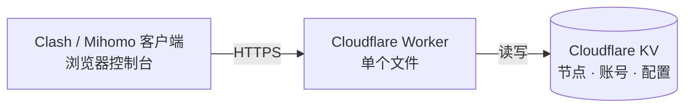

<div align="center">

# Transit Hub

**把 Clash 订阅，放进一个 Cloudflare Worker 里。**

Clash / Mihomo 订阅生成器 · 可视化管理控制台 · 零运行时依赖

<br>


<br><br>

[快速开始](#-快速开始) · [功能](#-功能) · [接口](#-接口) · [安全设计](#-安全设计)

</div>

---

> **仓库不含任何节点。** 没有服务器地址、没有 UUID、没有密码和公钥。首次部署拿到的是一份空配置 —— 节点全部由你在控制台里添加，也只存在你自己的 KV 里。

## 🧭 架构一览



一个 Worker，一个 KV，没有服务器、没有数据库、没有 `node_modules` 运行时。控制台前端在构建时被压进 Worker，**部署产物只有一个文件**。

## ✨ 功能

| 模块 | 能力 |
| :--- | :--- |
| **订阅** | `/?token=…` 直接输出可用的 Clash / Mihomo YAML，12 小时自动更新；配置流量后附带 `subscription-userinfo` |
| **节点** | 增删改、启停、拖序、搜索筛选、Shift 连选、批量操作与一键撤销 |
| **分组** | 自定义策略组，改名 / 换图标 / 调顺序；节点随分组走，改名不断链 |
| **导入导出** | VLESS、Hysteria2、Trojan、VMess、SS 分享链接批量互转 |
| **预览** | 实时 YAML、分组统计、全文搜索、复制与下载 |
| **账号** | 所有者 / 成员两级，成员只管自己的节点，共享节点由所有者分配 |
| **伪装** | 令牌不对时返回一个像模像样的「IP 地址查询」页，而不是 404 |

**支持协议**：VLESS（Reality / WS / gRPC）· Hysteria2 · Trojan · VMess · Shadowsocks（SIP002）

## 🚀 快速开始

### ① 部署

[](https://deploy.workers.cloudflare.com/?url=https://github.com/jinhuaitao/Clash)

或连接仓库：Workers & Pages → **Create** → **Workers** → **Import a repository**

| 项 | 值 |
| :--- | :--- |
| Build command | `npm run build` |
| Deploy command | `npx wrangler deploy` |

KV 命名空间会在首次部署时自动创建并绑定（`wrangler.toml` 里故意不写 `id`），之后复用同一个。若 Wrangler 报 `Missing id`，手动建一个填进去：

```bash
npx wrangler kv namespace create SUB_KV
```

### ② 上锁

```bash
npx wrangler secret put ADMIN_TOKEN   # 16 位以上的随机字符串
```

> ⚠️ **没配这个，`/api/setup` 直接返回 `503`。** 未初始化的实例不会给任何人抢注所有者的机会。只有本地开发或一次性实例，才用 `ALLOW_OPEN_SETUP=1` 回到零配置模式。

### ③ 初始化

打开 `https://<worker>.<子域>.workers.dev/admin`，依次完成：

**填 `ADMIN_TOKEN`** → **创建所有者账号** → **设置页生成并保存 `AUTH_TOKEN`** → **添加第一个节点**

保存即写入 KV，客户端下次刷新订阅就能拿到新配置。

## ⚙️ 环境变量

| 名称 | 说明 | 必填 |
| :--- | :--- | :---: |
| `ADMIN_TOKEN` | 初始化校验 + 找回密码的恢复通道，不参与日常登录。少于 16 位或含空白直接忽略 | ✅ |
| `ALLOW_OPEN_SETUP` | 设为 `1` 允许无 `ADMIN_TOKEN` 初始化，仅限本地 / 一次性实例 | — |
| `AUTH_TOKEN` | 订阅令牌，也可只在设置页生成（页面值优先） | — |
| `SESSION_SECRET` | 会话签名密钥，32–256 位。配置后 KV 被读走也无法伪造会话 | — |
| `SESSION_TTL_HOURS` | 会话有效期，默认 `168`（7 天），范围 1–168 | — |
| `PASSWORD_ITERATIONS` | PBKDF2 迭代次数，默认 `10000`（免费版 CPU 限制），付费计划建议 `200000` | — |

<details>
<summary><b>可选：边缘限流绑定</b></summary>

`wrangler.toml` 声明了两个 `[[ratelimits]]`：`/api/*` 120 次/分钟、订阅与伪装页 240 次/分钟。Worker 内存里的桶按 isolate 计数，换个 isolate 就重置；这两个绑定把计数放到边缘，按 IP 跨 isolate 生效。删掉不会报错，只是限流变弱。

</details>

## 👥 账号模型

| 角色 | 权限 |
| :--- | :--- |
| **所有者** | 管理账号、增删全部节点、修改设置，用 `AUTH_TOKEN` 拉取全量订阅 |
| **成员** | 只看分配给自己的共享节点，可增删自己的个人节点（上限 100 个），能自助改密 |

- 每个账号有独立订阅链接 `sub_<定位段>.<签名>`，由 `secret` 与账号版本派生、不落库；改密后旧链接立即失效。
- 会话是 HMAC 签名令牌，存 `sessionStorage`，关标签页即失效；重置密码会作废该账号全部旧会话。
- 账号上限 20 人、节点上限 300 个、分组上限 24 个。
- **`ADMIN_TOKEN` ≠ `AUTH_TOKEN`**：前者是恢复通道，后者只能拉订阅、不能登录控制台，别复用同一个值。

<details>
<summary><b>忘记密码 / 用户数据损坏</b></summary>

- 配了 `ADMIN_TOKEN`：登录页点「使用部署恢复令牌」进控制台，到设置页重置密码。
- 没配过：补一个 16 位以上的 Secret，在 Cloudflare 控制台的 KV 里删除 `users` 记录，重新打开 `/admin` 创建账号，最后「导入备份」恢复节点。
- 提示「用户数据已损坏」时 `/api/setup` 会拒绝自动初始化，防止任意访问者覆盖原数据。

</details>

## 🔌 接口

| 方法 | 路径 | 鉴权 | 说明 |
| :--- | :--- | :--- | :--- |
| `GET` `HEAD` | `/?token=…` | 查询令牌或 `Bearer` | 订阅 YAML；令牌错误返回伪装页 |
| `GET` | `/admin` `/console` | 页面内登录 | 控制台 |
| `GET` | `/api/auth` | 公开 | `needsSetup` / `setupLocked` / `recovery` / `corrupted` |
| `POST` | `/api/setup` | 公开 | 创建首个管理员；未配 `ADMIN_TOKEN` 返回 `503` |
| `POST` | `/api/login` | 公开 | 用户名或邮箱 + 密码 |
| `GET` | `/api/config` | 会话 | 配置与运行状态，成员的响应只含其可见节点 |
| `PUT` | `/api/config` | 所有者 | 整体保存（含 `groups`），`rev` 乐观锁 |
| `PUT` | `/api/nodes` | 成员 | 保存个人节点，`personalRev` 乐观锁 |
| `GET` | `/api/preview` | 会话 | 当前配置渲染出的 YAML |
| `POST` | `/api/password` | 会话 | 自助改密，返回新会话令牌 |
| `GET` `POST` | `/api/users` `/update` `/delete` | 所有者 | 账号列表、新建、改角色 / 范围 / 密码、删除 |

`/api/*` 也接受 `Bearer <ADMIN_TOKEN>` 作为恢复通道。登录失败按 IP + 用户名 10 分钟 8 次，同 IP 批量试探另有 10 分钟 60 次总闸；请求体超过 256 KB 直接 `413`。

<details>
<summary><b>KV 数据结构</b></summary>

```json
{
  "v": 1, "rev": 3,
  "authToken": "…", "providerBase": "",
  "defaults": { "vlessUuid": "…", "vlessPublicKey": "…", "vlessServername": "…", "vlessPort": 443 },
  "subscription": { "totalGB": 500, "expire": "2026-12-31" },
  "groups": [{ "id": "hk", "name": "🇭🇰港台节点", "icon": "https://…/Hong_Kong.png" }],
  "regionOrder": { "hk": ["n_xxx"] },
  "nodes": [{ "id": "n_xxx", "name": "HK-01", "type": "vless", "server": "example.com",
              "port": 443, "groupId": "hk", "enabled": true, "uuid": "…", "reality": true }]
}
```

`config` 键存配置，`users` 键单独存账号（`role` / `scope` / `passwordSalt` / `passwordHash` / `version`）与会话签名用的 `secret`。字段残缺或类型不对的节点在渲染时被跳过，不会把 `"undefined"` 写进订阅，也不会让整条订阅 500。

</details>

## 🔐 安全设计

- **初始化 fail-closed**：没有 `ADMIN_TOKEN` 时 `/api/setup` 返回 `503`，部署顺序是「先配 Secret → 再开 `/admin` → 创建所有者」。
- **凭据形态是硬门槛**：令牌少于 16 位、含空白或控制字符时一律忽略，不会「将就着用」。
- **口令**：最短 12 位，拒绝常见弱口令、单字符重复、键盘序列与「等于用户名」；不强制字符组合，长口令短语照样可用。
- **令牌不外泄**：设置页与 `/api/config` 都不回显订阅令牌，备份 JSON 不含令牌；唯一明文是 `meta.subUrl`，等价于订阅链接本身。
- **成员边界**：专属令牌只能取 `scope` 内的共享节点和自己的个人节点，不能登录控制台。
- **TLS 校验默认开启**：只有自签证书且确认链路可信时才勾「跳过证书校验」。
- **响应头**：CSP（`script-src` / `style-src` 全走 nonce）、`X-Frame-Options: DENY`、COOP / CORP、HSTS、`noindex`。
- **不可见字符会被拒**：节点名、用户名、服务器地址里的零宽 / 双向控制符，写入与渲染两处都拦。

## 🛠 本地开发

```bash
npm install
npm test           # 零依赖接口回归，300 项断言，不联网
npm run build      # 内联 admin/，产出 dist/1.js
npm run dev        # 构建 + wrangler dev → http://127.0.0.1:8787/admin
```

`npm run check` 是零依赖静态检查器，专拦「语法合法、运行时才炸」的问题（声明前使用、未缓存 `el.x`、id 缺失或重复、空 `catch`、CSS 类未覆盖），随 `build` 自动执行。

<details>
<summary><b>目录结构</b></summary>

```text
admin/                 控制台前端，构建时内联进 Worker
src/worker.js          Worker 入口（ES Module）
src/static-head.yaml   订阅 YAML 固定头部（端口 / DNS / 模式）
src/rules.yaml         分流规则与 rule-providers
build.mjs              内联前端，输出 dist/1.js
scripts/check.mjs      零依赖静态检查器
scripts/api.test.mjs   零依赖接口回归测试
wrangler.toml          Worker 配置 + KV / 限流绑定声明
```


</details>

---

<div align="center">

**MIT License** · 再分发时保留版权行即可

<sub>节点数据只在你的 KV 里 · 定期导出备份</sub>

</div>
